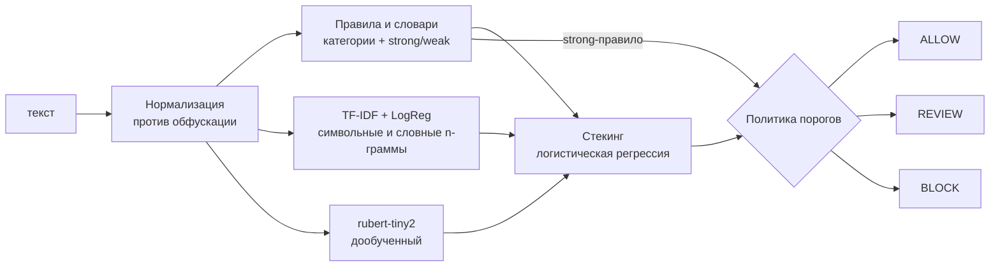

# Сервис модерации UGC

Сервис принимает текст пользовательского сообщения на русском языке и возвращает решение модерации: **ALLOW**, **REVIEW** или **BLOCK**, причины (категории нарушений) и уверенность.

```json
POST /moderate  {"text": "Я тебя н а й д у, понял?"}
-> {"decision": "BLOCK", "categories": ["threat"], "confidence": 0.99}
```

**Итоговые метрики** - в [`reports/SUMMARY.md`](reports/SUMMARY.md) (качество на тесте, устойчивость к обфускации, throughput в messages/min). Как получить их заново - в разделе ["Воспроизведение результатов"](#воспроизведение-результатов).

---

## Содержание

1. [Быстрый старт](#быстрый-старт)
2. [Архитектура](#архитектура)
3. [Решения и допущения](#решения-и-допущения)
4. [Системные требования](#системные-требования)
5. [Установка](#установка)
6. [Данные и модели](#данные-и-модели)
7. [Запуск API](#запуск-api)
8. [Тесты](#тесты)
9. [Нагрузочное тестирование](#нагрузочное-тестирование)
10. [Воспроизведение результатов](#воспроизведение-результатов)
11. [Конфигурация и переменные окружения](#конфигурация-и-переменные-окружения)
12. [Структура репозитория](#структура-репозитория)
13. [Ограничения и что улучшить](#ограничения-и-что-улучшить)

---

## Быстрый старт

```bash
git clone https://github.com/<user>/ugc-moderation.git && cd ugc-moderation
python3 -m venv .venv && source .venv/bin/activate
make install

# вариант А: скачать обученные модели (~1 мин)
make download-models MODELS_URL=https://github.com/<user>/ugc-moderation/releases/download/v1.0.0/models.tar.gz
# вариант Б: обучить с нуля (~20-40 мин на ноутбуке)
make data train

make serve        # API на http://localhost:8000, Swagger: http://localhost:8000/docs
```

Полный цикл "данные -> обучение -> метрики -> нагрузка -> сводка" одной командой: `make all`.

Проверить, что код работает, **без интернета и за 1-2 минуты**: `make smoke` (синтетические данные + крошечная модель; метрики smoke-прогона ничего не говорят о качестве).

---

## Архитектура



Три независимых алгоритма, у каждого своя сильная сторона:

| Компонент | Что ловит | Цена |
|---|---|---|
| **Правила и словари** (`moderation/rules.py`, `lexicon.py`) | Однозначные нарушения: мат, угрозы, сбыт наркотиков, торговля документами и оружием, оскорбления по признаку группы. Дают **категории** и **evidence** - фрагменты текста, на которых сработали | доли миллисекунды |
| **TF-IDF + логистическая регрессия** (`models/linear.py`) | Лексические паттерны токсичности. Символьные n-граммы устойчивы к опечаткам и частичной обфускации. Хеширование вместо словаря: артефакт ~10 МБ | доли миллисекунды |
| **rubert-tiny2** (`models/transformer.py`) | Смысл без явных маркеров: "таким, как ты, не место среди людей". 29M параметров - быстрый на CPU | основная часть времени |

Время по компонентам на конкретной машине - `make benchmark` -> `reports/benchmark.json`.

**Нормализация** (`moderation/normalize.py`) снимает типовые способы обхода фильтров до того, как текст попадёт к правилам и моделям:

| Обход | Пример | После нормализации |
|---|---|---|
| латиница вместо кириллицы | `дуpак`, `тyпой` (p, y - латинские) | `дурак`, `тупой` |
| цифры и символы | `3л0й ур0д` | `злой урод` |
| разрядка | `д у р а к`, `д.у.р.а.к` | `дурак` |
| повторы | `тупоооой` | `тупой` |
| невидимые символы | `ду\u200bрак` | `дурак` |
| маскировка | `д*рак`, `мр**ь` | распознаётся правилами по маске |

Латиница заменяется только в русском тексте, поэтому `iPhone 15 Pro` и `covid19` не портятся.

**Ансамбль** (`moderation/policy.py`): логистическая регрессия поверх сигналов компонентов (логиты двух моделей и weak-срабатывания правил) даёт калиброванную вероятность нарушения `P`. Решение:

- сработало **strong-правило** -> `BLOCK`;
- `P >= t_block` -> `BLOCK`;
- `P < t_allow` -> `ALLOW`;
- иначе -> `REVIEW`.

**Сервис** (`moderation/api.py`): FastAPI с **микробатчингом** (`moderation/batcher.py`) - одиночные конкурентные запросы собираются в батчи до 64 штук или 5 мс и проходят через модели вместе. Под нагрузкой это кратно поднимает throughput, а задержка вырастает максимум на 5 мс.

---

## Решения и допущения

Ответы заказчика на уточняющие вопросы и то, как они реализованы:

| Вопрос | Ответ | Реализация |
|---|---|---|
| Целевой список категорий? | Нет, на усмотрение | Своя таксономия: `profanity` (мат), `insult` (оскорбления), `threat` (угрозы), `illegal_activity` (наркотики, документы, оружие). Если нарушение нашли модели, а не правила, - `toxicity` |
| Что критичнее? | Пропуск нарушения | Порог `t_allow` подбирается так, чтобы **>= 95% нарушений не получали ALLOW** (`policy.target_recall`) |
| Сколько отдавать на ручную модерацию? | Минимум; можно ансамбль алгоритмов | Три алгоритма + стекинг. Порог `t_block` - минимальный, при котором точность автоблокировки >= 90% (`policy.target_block_precision`): так зона REVIEW получается **минимальной** при заданном качестве BLOCK |

Как меняется доля REVIEW при других целях - таблица [`reports/tradeoff.md`](reports/tradeoff.md). Цели меняются в конфиге или переменными окружения без переобучения моделей: нужен только `make calibrate`.

**Данные.** Основной датасет - [`AlexSham/Toxic_Russian_Comments`](https://huggingface.co/datasets/AlexSham/Toxic_Russian_Comments) (комментарии ok.ru, ~223k train / ~25k test, метка `1` - токсично). Он однородный и с понятной разметкой. Во втором предложенном датасете (`Mnwa/russian-toxic`) неочевидное направление меток (`0 negative` - по примерам похоже на токсичные) и заметный шум, поэтому он не использовался.

**Методология оценки.**
- Удалены дубликаты и тексты из train, совпадающие с test после нормализации (утечка).
- Направление меток проверяется автоматически: у токсичного класса однозначных правил должно срабатывать больше.
- Валидация (10% train) делится пополам: на части A обучается стекинг, на части B подбираются пороги. Тест в подборе не участвует.

**`confidence`** - уверенность в принятом решении: для `BLOCK` и `REVIEW` это P(нарушение), для `ALLOW` - P(норма). Для срабатывания однозначного правила - не ниже 0.99.

---

## Системные требования

- **Python 3.10-3.13** (проверено на 3.13)
- macOS / Linux, 8 ГБ RAM
- GPU не нужен. Обучение трансформера автоматически использует CUDA или Apple MPS, если они есть; сервис по умолчанию работает на CPU, и все замеры скорости сделаны на CPU
- ~2 ГБ на диске (зависимости, датасет, модели)
- Docker - опционально

## Установка

```bash
python3 -m venv .venv
source .venv/bin/activate
make install            # = pip install -r requirements-dev.txt
```

- `requirements.txt` - рантайм сервиса (FastAPI, scikit-learn, torch, transformers).
- `requirements-dev.txt` - плюс данные, обучение, тесты и нагрузка (datasets, pandas, pytest, httpx).

Без `make`: все команды ниже - это вызовы `python scripts/...`, их можно запускать напрямую (см. `Makefile`).

## Данные и модели

```bash
make data               # скачать датасет с Hugging Face -> data/processed/{train,val,test}.parquet
make train-linear       # TF-IDF + LogReg -> models/linear.joblib                   (~2-5 мин)
make train-transformer  # дообучение rubert-tiny2 -> models/transformer/            (~15-30 мин)
make calibrate          # стекинг и пороги -> models/policy.json, reports/tradeoff.md (~1-2 мин)
# или всё сразу:
make train
```

Базовая модель `cointegrated/rubert-tiny2` скачивается с Hugging Face автоматически при первом запуске `train-transformer`.

**Готовые модели** вместо обучения:

```bash
make download-models MODELS_URL=https://github.com/<user>/ugc-moderation/releases/download/v1.0.0/models.tar.gz
```

Архив для релиза собирается командой `make package-models`.

## Запуск API

```bash
make serve                          # = uvicorn moderation.api:app --host 0.0.0.0 --port 8000
```

Через Docker (модели монтируются из `./models`):

```bash
make docker-build && make docker-run
```

### Эндпоинты

| Метод | Путь | Описание |
|---|---|---|
| `POST` | `/moderate` | одно сообщение |
| `POST` | `/moderate/batch` | до 1000 сообщений за запрос |
| `GET` | `/health` | статус и список компонентов |
| `GET` | `/docs` | Swagger UI |

### Пример запроса

```bash
curl -s -X POST http://localhost:8000/moderate \
  -H 'Content-Type: application/json' \
  -d '{"text": "Закладки меф, пиши в телегу @fast_shop"}'
```

```json
{"decision": "BLOCK", "categories": ["illegal_activity"], "confidence": 0.99}
```

С параметром `?explain=true` в ответ добавляются фрагменты, на которых сработали правила, и оценки каждого компонента:

```json
{"decision": "BLOCK", "categories": ["illegal_activity"], "confidence": 0.99,
 "evidence": ["закладки", "меф"],
 "scores": {"linear": 0.93, "transformer": 0.97, "ensemble": 0.99}}
```

Пакетный запрос:

```bash
curl -s -X POST http://localhost:8000/moderate/batch \
  -H 'Content-Type: application/json' \
  -d '{"texts": ["Отличная статья, спасибо!", "Я тебя найду и урою"]}'
```

```json
{"results": [{"decision": "ALLOW", "categories": [], "confidence": 0.98},
             {"decision": "BLOCK", "categories": ["threat"], "confidence": 0.99}]}
```

Примеры сообщений с ожидаемыми решениями - [`data/samples/messages.jsonl`](data/samples/messages.jsonl).

## Тесты

```bash
make test               # = pytest
```

- `test_normalize.py`, `test_rules.py` - деобфускация, срабатывания и **отсутствие ложных срабатываний** ("небо", "хлеб", "Ебола", "забью гол", "Педро", "хачапури"...);
- `test_policy.py` - пороги выполняют целевые recall и precision, strong-правило всегда блокирует;
- `test_api.py` - контракт API на заглушке (работает без обученных моделей);
- `test_batcher.py` - микробатчинг объединяет запросы, ошибка батча не роняет сервис;
- `test_integration.py` - сквозной прогон на обученных моделях (пропускается, если моделей нет).

## Нагрузочное тестирование

```bash
make loadtest           # поднимает сервис, нагружает 30 с, останавливает
```

Скрипт `scripts/run_loadtest.sh` запускает API в фоне и выполняет два сценария `scripts/loadtest.py`:

1. **одиночные запросы** `POST /moderate`, 32 параллельных клиента;
2. **батчи** `POST /moderate/batch` по 64 сообщения, 4 клиента.

Результат - **throughput в messages/min**, задержки p50/p95/p99 и число ошибок, в `reports/loadtest_single.json` и `reports/loadtest_batch.json`. Тексты берутся из тестовой выборки.

Параметры: `DURATION=60 CONCURRENCY=64 make loadtest`. Нагрузить уже запущенный сервис:

```bash
python scripts/loadtest.py --url http://localhost:8000 --concurrency 32 --duration 30
```

Офлайн-скорость без HTTP (по размеру батча и по компонентам): `make benchmark` -> `reports/benchmark.json`.

## Воспроизведение результатов

На чистом окружении:

```bash
make install
make data train         # или make download-models MODELS_URL=...
make evaluate           # качество и устойчивость -> reports/metrics.md, reports/metrics.json
make benchmark          # офлайн-скорость       -> reports/benchmark.json
make loadtest           # throughput API        -> reports/loadtest_*.json
make report             # сводка                -> reports/SUMMARY.md
```

Или всё одной командой: `make all`.

**Что считает `make evaluate`:**

- метрики каждого компонента отдельно и ансамбля: ROC-AUC, PR-AUC, precision, recall, F1;
- решения сервиса: доли ALLOW / REVIEW / BLOCK, доля пойманных нарушений, пропуски, точность автоблокировки, ложные блокировки;
- **устойчивость к формулировкам**: те же метрики на тестовых текстах, искажённых шестью способами обхода (латиница, leet, разрядка, повторы, звёздочки, невидимые символы), **с нормализацией и без неё** - видно, сколько даёт каждый слой защиты;
- распределение категорий среди REVIEW и BLOCK.

## Конфигурация и переменные окружения

Все параметры - в [`configs/config.yaml`](configs/config.yaml): пути к данным и моделям, гиперпараметры, целевые значения порогов, параметры микробатчинга.

| Переменная | По умолчанию | Назначение |
|---|---|---|
| `MODERATION_CONFIG` | `configs/config.yaml` | путь к конфигу |
| `MODERATION_DEVICE` | `cpu` | устройство инференса трансформера в сервисе: `cpu` / `cuda` / `mps` / `auto` |
| `MODERATION_USE_TRANSFORMER` | `true` | выключить трансформер (нужна перекалибровка: `make calibrate`) |
| `MODERATION_TORCH_THREADS` | `0` (по умолчанию torch) | число потоков CPU |
| `MODERATION_TARGET_RECALL` | `0.95` | доля нарушений, не получающих ALLOW (для `make calibrate`) |
| `MODERATION_TARGET_BLOCK_PRECISION` | `0.90` | точность автоблокировки (для `make calibrate`) |
| `MODERATION_BATCH_MAX_SIZE` | `64` | максимальный размер микробатча |
| `MODERATION_BATCH_MAX_WAIT_MS` | `5` | максимальное ожидание сборки батча |

## Структура репозитория

```
moderation/            код сервиса
  normalize.py           нормализация против обфускации
  lexicon.py, rules.py   словари, шаблоны, категории
  models/                линейная модель и трансформер
  policy.py              стекинг и пороги ALLOW/REVIEW/BLOCK
  moderator.py           сборка пайплайна
  batcher.py, api.py     микробатчинг и REST API
  perturb.py             искажения для теста устойчивости
scripts/               данные, обучение, калибровка, оценка, бенчмарк, нагрузка, сводка
  dev/                   синтетика и крошечная модель для make smoke
configs/               config.yaml (основной), smoke.yaml (проверка без интернета)
tests/                 pytest
data/samples/          примеры сообщений
reports/               итоговые метрики
```

## Ограничения и что улучшить

- **Категории не размечены в датасете**, поэтому их качество не измерено так же строго, как бинарное решение. Следующий шаг - разметить 1-2 тыс. токсичных сообщений по категориям (LLM + выборочная ручная проверка) и обучить multi-label голову.
- **Словари консервативны**: точность важнее полноты, полноту дают модели. Список нужно расширять по логам REVIEW.
- **Маскировка звёздочками - самое слабое место** (см. таблицу устойчивости): правила восстанавливают только слова из словаря масок, а модели теряют сигнал, когда часть букв скрыта. Улучшение - аугментация обучающей выборки теми же искажениями из `perturb.py`.
- **Модели видят одно сообщение без контекста** (ветки, статьи, истории автора) - контекст сильно помогает с сарказмом и цитированием.
- **Дрейф**: способы обхода фильтров меняются. Решения модераторов по REVIEW - готовая разметка для регулярного дообучения.
- **Скорость**: при необходимости трансформер экспортируется в ONNX / квантуется в int8; сервис масштабируется горизонтально (stateless).
- **LLM для зоны REVIEW** - возможное расширение для спорных случаев: в основной путь не включена из-за требований к скорости и работы без внешних ключей.
